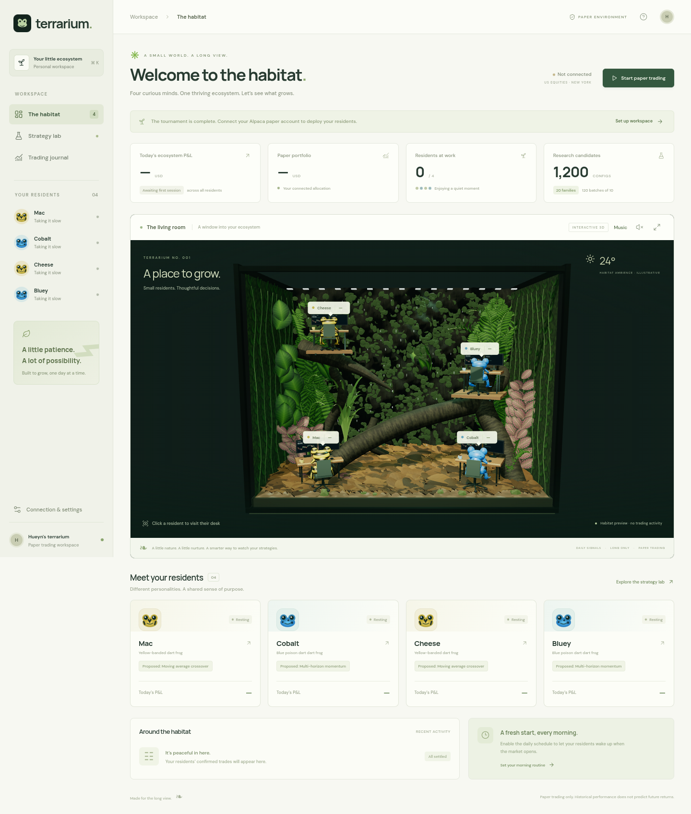
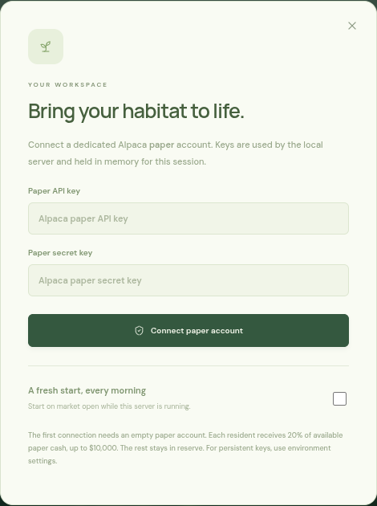

<div align="center">
  
  <h1>Terrarium</h1>
  <p><strong>A little world for researching strategies and watching paper trades.</strong></p>
  <p>Four frog residents · Interactive 3D habitat · 1,200 research configurations · Alpaca paper trading</p>
  <p><a href="#run-on-windows">Get started</a> · <a href="#your-first-paper-trading-session">Start paper trading</a> · <a href="docs/gallery.md">Screenshot gallery</a> · <a href="docs/results.md">Research results</a></p>
</div>



Terrarium combines an ETF strategy tournament, a local paper-trading controller, and a living dashboard. Visit Mac, Cheese, Cobalt, and Bluey at their desks; orbit the frogs with a free camera; or leave the whole habitat open with soft jazz or quiet piano.

**Paper trading only.** The application has no real-money trading endpoint. Historical rankings are research results, not a promise of profit. The tournament tests **1,200 configurations of 20 strategy families**, rather than 1,200 independently researched methods. [Research coverage and limitations →](docs/research-notes.md)

## What is inside

| Feature | What you can do |
|---|---|
| **The habitat** | Watch all four residents among branches, ferns, fittonia, moss, leaf litter, and animated water droplets. |
| **Resident desks** | Click a frog or its resident card to visit its monitors and see its positions and session P&L. |
| **Free camera** | Orbit 360°, zoom, and pan around a selected resident. |
| **Off-duty routines** | Resting frogs independently nap, stretch, drink coffee, or hunt tiny crawling fruit flies when the market is closed. |
| **Music** | Play the included soft jazz or quiet piano loops; choose a track and volume. No streaming service required. |
| **Strategy lab** | Run 120 batches of ten configurations, inspect the finalists and equity curves, and download the detailed report. |
| **Paper trading** | Connect a dedicated Alpaca paper account, start a session, or enable the daily market-open schedule. |
| **Trading journal** | Review controller events and confirmed fills; orders and resident balances persist in a local SQLite ledger. |
| **Adaptive graphics** | The habitat adjusts rendering quality for sustained slow frames while keeping dashboard text sharp. |

The habitat is a procedural, stylized interpretation of the reference terrarium. Animations are decorative; they never create orders or profits. [See every screen and feature →](docs/gallery.md)

## Run on Windows

### 1. Install the prerequisites

For a **GitHub clone or GitHub “Download ZIP”**, install:

- **Python 3.12, 64-bit**, including the Python launcher (`py`).
- **Node.js 22.12 or newer**, including npm. Node.js 24 is also supported.
- **Git**, if you prefer cloning instead of downloading a source ZIP.

Open a new terminal after installation and check:

```powershell
py -3.12 --version
node --version
npm.cmd --version
```

The separately prepared **`terrarium-windows.zip`** already contains the built dashboard, so that particular bundle needs Python but does not need Node.js unless you rebuild it. GitHub's automatically generated source ZIP does **not** contain the built dashboard.

### 2. Get the project

```powershell
git clone https://github.com/HU3YN/tradingbotv4.git
cd tradingbotv4
```

Alternatively, use GitHub **Code → Download ZIP** and extract it completely. Keep the project in a permanent folder, such as `C:\Users\YourName\Documents\tradingbotv4`. Do not run it from inside a ZIP archive.

### 3. Install and start

1. Double-click **`Setup-Windows.cmd`**. It creates the Python environment, installs the pinned dependencies, and builds the dashboard when needed. Wait for **Setup complete**. The first setup requires internet access.
2. Double-click **`Start-Terrarium.cmd`**. Leave its server window open.
3. Open **http://127.0.0.1:8000** in Edge or Chrome on that same computer.

You should see the habitat with four residents. Profit values remain blank until a paper account and ledger have real values. Follow the first-session steps below before starting trading.

[Detailed Windows guide and troubleshooting →](docs/windows-quickstart.md)

## Run on macOS or Linux

Install Python 3.12 and Node.js 22.12+ first. Ensure `python3` resolves to Python 3.12, then:

```bash
git clone https://github.com/HU3YN/tradingbotv4.git
cd tradingbotv4
bash scripts/setup.sh
bash scripts/start.sh
```

Open **http://127.0.0.1:8000** on the same machine. Keep the terminal running. The application binds to the local machine; opening the dashboard on a phone is not a supported network deployment out of the box, although its layout and touch controls adapt to mobile screens.

## Your first paper-trading session

### 1. Run the historical tournament

Open **Strategy lab → Run historical tournament**. Wait until the run completes and the finalist table appears.

The application downloads adjusted daily ETF prices, validates the data, and evaluates the most recent five years, with additional history for indicator warm-up. It tests 1,200 configurations in 120 batches, chooses candidates using a validation period, and evaluates the frozen finalists on a later holdout period. Modeled trades execute at the next open with 10 basis points of costs per side.

A clean source checkout starts without historical caches or a tournament report. Running the lab creates them locally. If the download fails or a freshness check rejects the data, resolve that error before starting trading; the app does not substitute invented market prices.

### 2. Connect Alpaca paper trading

1. Sign in to [Alpaca](https://app.alpaca.markets/) and switch to **Paper Trading**.
2. Use a dedicated paper account with **no existing positions or open orders for the first initialization**. It needs at least **$500 of simulated cash**.
3. Obtain the paper account's API key and secret.
4. In Terrarium, open **Connection & settings**.
5. Enter the two keys and click **Connect paper account**.

Enter keys only in your local app. The settings form keeps them in server memory for that session; restarting the server requires reconnecting. Do not put keys in GitHub, screenshots, or chat. The app also accepts `ALPACA_API_KEY` and `ALPACA_SECRET_KEY` from the server environment for unattended restarts. It does not automatically load a `.env` file.



### 3. Start manually or enable the daily schedule

| Mode | How to use it | What happens |
|---|---|---|
| **One session** | During regular US market hours, click **Start paper trading**. | The residents run for that market session; manual arming ends at the close. |
| **Daily schedule** | After connecting, enable **A fresh start, every morning** in settings. | The server waits for Alpaca to report an open market, then runs on future sessions while the schedule remains enabled. |

The scheduler checks the broker clock about every 20 seconds. Keep the computer awake, the server running, and the internet connected. Exchange holidays and early closes follow Alpaca's clock. The stored daily schedule survives a normal server restart, but credentials entered in the form do not; reconnect them after restarting.

**Daily signals do not mean constant trading.** Orders depend on each assigned strategy's rebalance rule and current holdings. A resident can be watching the market without placing an order. The current documented finalists use weekly rebalancing, so an open market does not guarantee a trade that day.

### 4. Know how the four residents are funded

| Resident | Species | Initial assignment |
|---|---|---|
| **Mac** | Yellow-banded poison dart frog | Validation rank 1 |
| **Cheese** | Yellow-banded poison dart frog | Validation rank 1 |
| **Cobalt** | Blue poison dart frog | Validation rank 2 |
| **Bluey** | Blue poison dart frog | Validation rank 3 |

Each resident receives **20% of the account's initial cash, capped at $10,000 per resident**. The remainder stays outside the resident ledgers. Deployment also keeps a 2% cash reserve. Strategies and starting allocations are stored when the ledger is initialized; rerunning research does not replace existing resident assignments.

### 5. Monitor and pause

- **Dashboard:** check daily ecosystem P&L, the allocated paper portfolio, active residents, connection state, and quote freshness.
- **Resident desk:** select a frog to inspect its strategy, positions, session P&L, and chart for its first held ETF. Uninitialized monitors do not invent prices.
- **Trading journal:** inspect confirmed fills and controller events. Confirm account-level orders and balances in Alpaca too.
- **Pause residents:** stops new submissions and requests cancellation of outstanding managed orders. **It leaves existing positions open.**

Closing the browser leaves the server running. Closing the server window stops the local controller, but does not close broker positions or automatically cancel previously submitted orders. When intentionally stopping a session, pause first and verify any outstanding orders in Alpaca before shutting down.

**Do not delete `data/paper.sqlite` to reset a running account.** It holds the resident balances, positions, account binding, and order history. Back it up while the server is stopped, or use SQLite's backup API. Keep the same ledger with the same paper account.

## A simple morning routine

1. If the server stopped, run `Start-Terrarium.cmd` and reconnect your paper keys.
2. Check connection status, the market clock, and any warning shown in the dashboard.
3. Confirm the daily schedule is enabled, or use **Start paper trading** once the market opens.
4. Leave the server running and the computer awake. Check the journal and Alpaca for fills or reconciliation errors.

Scheduled trading refreshes historical prices when it needs a new daily plan. If manual start reports stale research data, refresh from **Strategy lab**. Pause before starting a new research run.

## Explore the habitat

| Control | Action |
|---|---|
| Frog, resident name, or resident card | Fly to that resident's desk. |
| **Free camera** | Enable an orbit around the selected frog. Drag to orbit, scroll or pinch to zoom, and right-drag to pan. |
| **Return to desk view** | Reset the over-the-shoulder view. |
| **Back to the habitat** | Return to the whole tank. |
| Expand icon | Enter or leave fullscreen, where supported by the browser. |
| Speaker icon | Play or pause the music. |
| **Music** | Choose **Soft jazz** or **Quiet piano**, then adjust volume. Preferences are saved; playback starts paused after reload. |
| Help icon | Read the workspace's field notes and behavior explanations. |

Off-duty routines are independent and staggered. They run only while the market is closed and the resident has no active order. An open market, active order, or stale server status returns the frog to its desk. The disconnected preview uses regular New York weekday hours; confirmed holiday handling requires the broker clock.

[Full screenshot gallery: every screen, all four desks and camera views, music, mobile, and resting routines →](docs/gallery.md)

## Research and execution limits

The ETF universe is **SPY, QQQ, IWM, EFA, EEM, TLT, IEF, GLD, VNQ, DBC**. Strategies are long-only with cash available; no leverage or shorting is implemented. Source coverage, signal definitions, selection instability, and the difference between the validation winner and the hindsight maximum are documented in [research notes](docs/research-notes.md) and [results](docs/results.md).

Paper execution uses current Alpaca IEX snapshots and market orders, which differ from the historical simulator's idealized next-open fills. Your data entitlement must permit IEX snapshots. Historical returns are separate from resident paper P&L.

Session P&L starts at the first recorded valuation that day, excluding earlier overnight changes. Dividends, separately charged fees, cash adjustments, corporate actions, and manual broker activity can make broker P&L differ from the resident ledger. Position mismatches, unmanaged orders, or uncertain submission outcomes pause the controller for reconciliation. A 5% loss from the session baseline stops new orders; it is not a liquidation order or a guaranteed maximum loss.

The application has automated tests for research and broker accounting, but authenticated order placement and fills still need validation with your own paper account. Windows launchers are supplied; they have not been executed in this Linux development environment. [Verification details →](docs/verification.md)

## Update an existing installation

**From a Git clone:** pause trading and stop the server, then run:

```bash
git pull --ff-only
```

On Windows, run `Setup-Windows.cmd` to refresh Python dependencies, then explicitly rebuild the frontend:

```powershell
npm.cmd --prefix frontend ci
npm.cmd --prefix frontend run build
```

The setup launcher skips the frontend build when `frontend/dist/index.html` already exists, so the explicit rebuild is necessary after pulling dashboard changes. On macOS/Linux, rerun `bash scripts/setup.sh`, which rebuilds it. Restart the server and hard-refresh the browser with **Ctrl+F5** on Windows or **Cmd+Shift+R** on macOS.

**From the prepared cumulative ZIP:** stop the server, extract to a temporary folder, and follow its `READ-ME-FIRST.txt`. For the current update, copy `frontend` and `backend` into the existing installation and replace matching files. Keep your existing `data`, `reports`, Python environment, and keys. The bundle already includes the built frontend.

Local market data, research reports, credentials, and the paper ledger are excluded from Git. Normal pulls retain them. Do not run cleanup commands that erase ignored files: those files include your ledger.

## Troubleshooting

| Symptom | What to check |
|---|---|
| `py` or Python 3.12 not found | Install Python 3.12 with its launcher, then reopen the terminal. |
| `npm` not found or setup cannot build | Install Node.js 22.12+ and reopen the terminal. Use `npm.cmd` in PowerShell. |
| Port 8000 is already in use | Check whether another Terrarium server is still running. Use one server instance per ledger. |
| Page does not open | Keep the server window open; use `http://127.0.0.1:8000` on that same computer. |
| Old dashboard after an update | Rebuild source installs, restart the server, then hard-refresh the browser. |
| Market closed | Enable the daily schedule after connecting; wait for the next exchange session. |
| Connection rejected | Verify paper-mode keys, account status, and that the ledger belongs to that account. |
| Historical download or freshness error | Check internet/provider availability; rerun the lab and read the error before starting. |
| Residents are watching but not trading | Check the strategy's rebalance day, existing holdings, and journal. No new target can mean no order. |
| Position mismatch or uncertain order outcome | Pause, inspect Alpaca's orders/positions and the journal, and reconcile. Keep the ledger intact. |
| Habitat cannot render or runs slowly | Enable WebGL/hardware acceleration and use a current browser. Automatic quality adjustment helps slower devices. |
| Music stays silent | Press the speaker or **Play music**, check volume, and inspect the music panel for a retry message. |

## Development and verification

The backend is Python/FastAPI with a SQLite ledger. The frontend is TypeScript, Three.js, and Vite. Run a single backend with `bash scripts/start.sh`; for frontend development, start `npm --prefix frontend run dev` in a second terminal. Vite proxies `/api` to the backend.

```bash
# Backend checks
.venv/bin/pytest -q

# Frontend type checking and production build
npm --prefix frontend run build

# Animation and rendering unit checks
node --test frontend/idle-behavior.test.mjs frontend/resident-life.test.mjs frontend/render-performance.test.mjs

# Browser checks against the running production server
node frontend/browser-check.mjs
node frontend/music-check.mjs
```

On Windows, use `.venv\Scripts\python.exe -m pytest -q` for the backend tests. Browser checks default to `/usr/bin/chromium`; the checks above accept `CHROMIUM_EXECUTABLE` to select your installed Chromium executable. The general browser check expects a completed historical tournament.

For command-line research:

```bash
.venv/bin/pond download
.venv/bin/pond tournament
.venv/bin/python scripts/validate_results.py
```

On Windows, use `.venv\Scripts\pond.exe` and `.venv\Scripts\python.exe`. The generated tournament report includes candidates, batch/elimination results, hashes, cost assumptions, the benchmark, finalists, and equity curves. Synthetic runs are test fixtures and cannot be deployed.

| Location | Purpose |
|---|---|
| `backend/pond/` | Data validation, strategy signals, backtesting, tournament selection, broker adapter, trading controller, API. |
| `frontend/src/` | Dashboard, procedural habitat, resident behaviors, camera, performance budget, and music controls. |
| `frontend/public/` | Runtime icon and included soundtrack files. |
| `tests/` and `frontend/*check.mjs`, `frontend/*.test.mjs` | Accounting, research, API, browser, animation, and performance checks. |
| `scripts/` | Setup/start helpers, result auditing, soundtrack rendering, and Windows packaging. |
| `docs/` | Operating guides, research notes, results, and the current screenshot gallery. |
| `data/` and `reports/` | Locally generated state and research artifacts; excluded from source control. |

After building the frontend and generating the research files referenced by the packager, `python scripts/package_windows.py` recreates the single cumulative `terrarium-windows.zip` beside the project folder. It excludes credentials and the paper ledger. GitHub stores the source and current documentation screenshots; caches, build output, temporary captures, and redundant update archives are not committed.
